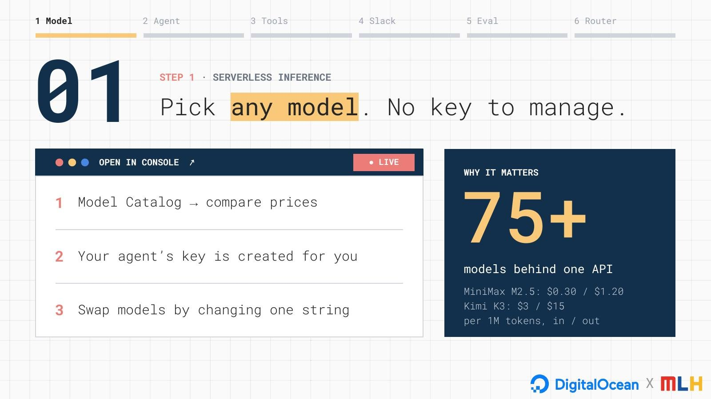
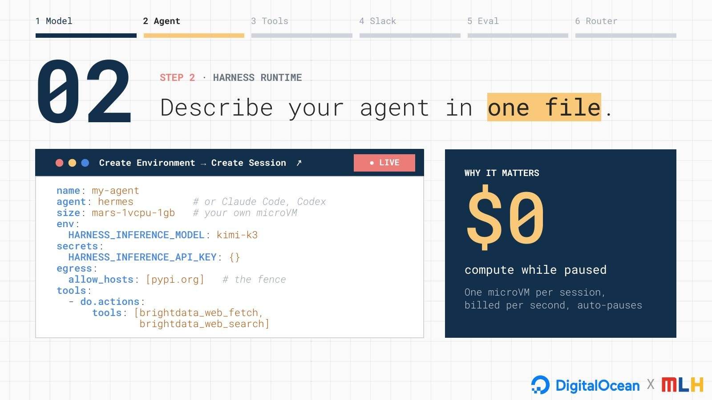
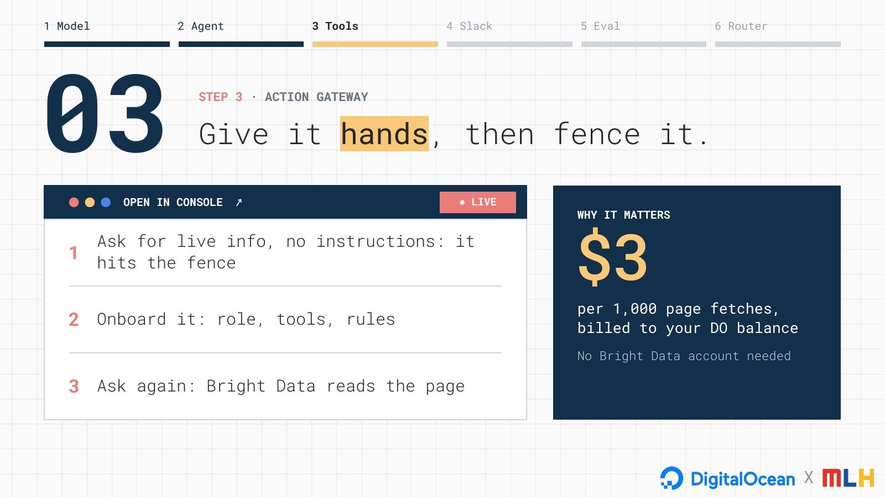
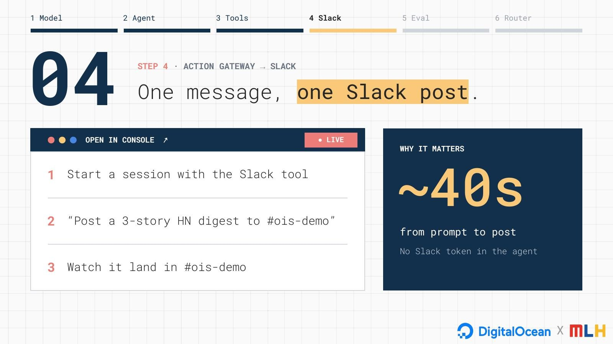
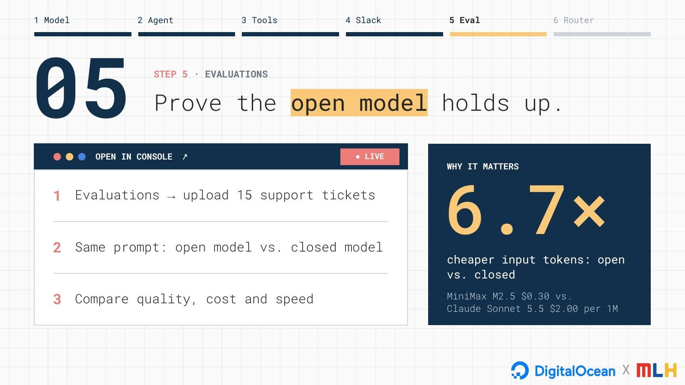
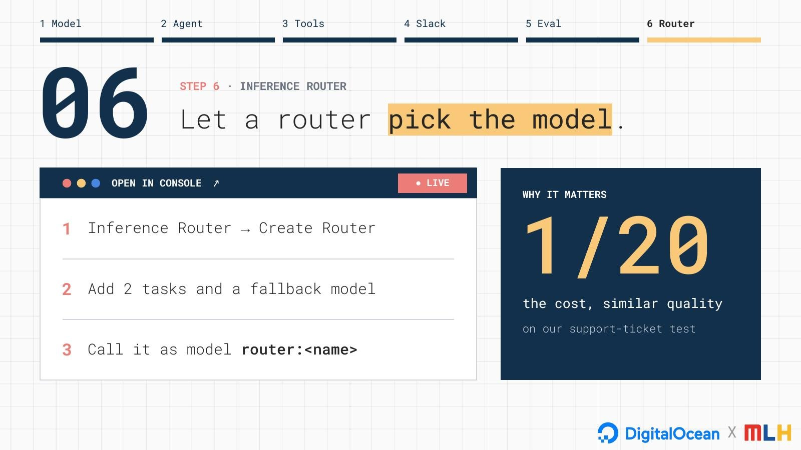

# The live demo, step by step

This is the agent we built live at the kickoff, in six steps, all in the DigitalOcean console. Follow along to build the same agent, then make it your own.

- **Time:** about 45 minutes.
- **You need:** a DigitalOcean account with workshop credits. There's nothing to install, and you don't need to create an API key, because DigitalOcean creates one for your agent.
- **The console may look slightly different** from the screenshots as DigitalOcean ships updates. If a button has moved, look for the same words nearby, or ask a coach.

---

## Step 1 · Pick any model



1. Sign in at [cloud.digitalocean.com](https://cloud.digitalocean.com).
2. In the sidebar under **Inference Engine**, open **Model Catalog**. Browse the open and closed models and compare their prices per million tokens.

Every model sits behind the same API, so switching models later means changing one string.

---

## Step 2 · Describe your agent



1. In the sidebar under **Managed Agents**, open **Harness Runtime**. On first use, click **Get started**, then **Continue with your balance**.
2. Click **Create Environment** and fill in the form:
   - **Harness:** Hermes
   - **Size:** `mars-1vcpu-1gb`
   - **Model:** an open model from the list. We used **Kimi K3**.
   - **Auto pause:** ticked. Choosing Hermes can untick it, so check it.
   - **Tools:** **Specific tools**, search "brightdata", tick **Bright Data (2)**.
   - **Egress / allowed hosts:** `pypi.org` only.
3. Click **Create Environment**.
4. Find the environment's manifest (its YAML view). This one file is the whole agent: harness, machine size, model, tools and fence. Compare it with [`environment.yaml`](environment.yaml).
5. Click **Create Session**, leave **Auto resume session** off, and confirm. The session shows **Running** in about 10 seconds: a fresh microVM, just for you.

> **Check the tool list.** If you have Slack or other tools connected, the form may switch all of them on. In our run it switched on about 70 Slack tools, including delete message and archive channel. Untick everything you don't need. An agent can't misuse a tool it doesn't have.

---

## Step 3 · Give it hands, then fence it



Your agent can only reach `pypi.org` directly. Send these three messages one at a time.

**a. Ask with no instructions:**

```
What are the top 3 stories on Hacker News right now?
```

**What happened live:** the agent tried everything it had: Python, `curl`, a browser user agent, checking for proxy settings, even skipping the proxy. All of it failed at the fence, and it told us it couldn't reach Hacker News.

**b. Onboard it like a new hire:**

```
For this whole session: use brightdata_web_search and brightdata_web_fetch for anything on the web. Your built-in web tools can't reach the internet here. Never print environment variables or secrets. Reply "Ready".
```

**c. Ask again:**

```
What are the top 3 stories on Hacker News right now?
```

**What happened live:** one `brightdata_web_fetch` call through DigitalOcean's Action Gateway, and the right top 3 stories. Click **Ran N tool calls** to see the tool doing the work. There's no Bright Data account or key in the agent; usage is billed to your DigitalOcean balance.

---

## Step 4 · One message, one Slack post *(optional)*



This step needs a Slack workspace you're allowed to test in.

1. In **Action Gateway** > **Connections**, connect your Slack workspace.
2. Edit your environment's tools. Keep both Bright Data tools, and from the Slack tools add **only `slack_post_message`**. Add `slack_post_message` to the preloaded tools too, so the agent doesn't spend time searching for it.
3. Start a **new session**, so it picks up the new tool list, and onboard it as in step 3b.
4. Send, with your own channel name:

```
Use slack_post_message exactly once to post a 3-story Hacker News digest to #<your-channel>: for each story, the title and its link. Post nothing else.
```

**What happened live:** a Bright Data fetch, then `slack_post_message` returned `ok: true`, and the digest landed in the channel. The agent never held a Slack token: DigitalOcean holds the keys.

**Tips:**
- Put the channel ID in the prompt (Slack: channel name → **View channel details**, ID at the bottom). It saves a lookup.
- Trust the tool result, not the agent's summary. No `ok: true` means no post.

---

## Step 5 · Prove it with an eval



An eval runs the same requests through two candidates, and a judge model scores every answer, so "which is better?" gets a number instead of a feeling.

**Live demo: open model vs. closed model** ([`evals/1-open-vs-closed`](evals/1-open-vs-closed/)):

1. In **Evaluations** > **Datasets**, upload [`ticket-triage.csv`](evals/1-open-vs-closed/ticket-triage.csv): 15 customer messages, each with the right queue and urgency.
2. Run it on an open model (MiniMax M2.5), then on a closed one (Claude Sonnet 5.5, behind a one-model router), with the same triage prompt, judge and metric.
3. Compare quality, cost and speed side by side, then read the judge's reasons on the misses.

**Going further: does a skill make your agent better?** ([`evals/2-agent-skill`](evals/2-agent-skill/)): two Hermes agents, identical except for the [`digitalocean-action-gateway`](skills/digitalocean-action-gateway/SKILL.md) skill, scored on whether they call the right tool first. It's slower and costs more, because the agents really carry out each request.

---

## Step 6 · Let a router pick the model



1. Under **Inference Engine**, open **Inference Router** and click **Create Router**. Name it, for example `my-router`.
2. Click **Add tasks** > **Add Custom Task** for each task below. The description is what the router reads to decide where each request goes.

| Task | Description | Optimization | Models |
|---|---|---|---|
| `code` | Programming requests: writing, explaining, reviewing or debugging code, shell commands, SQL, regex, API usage, error messages and stack traces. | Speed Optimization | Kimi K3 + DeepSeek V4 Pro |
| `chat` | Casual conversation and small talk: greetings, quick questions about the person, jokes, opinions and short friendly replies. No code, no support issues. | Cost Efficiency | Gemma 4 + OpenAI GPT-oss-20b |

3. Click **Add Fallback Models**, pick **OpenAI GPT-oss-120b**, then click **Create Router**.
4. **Test it:** in **Evaluations**, start a **New Evaluation** with candidate type **Model Router** and your router. Compare its score, cost and latency with a single model.

You call a router like any model, as `router:my-router`. If a model in the table isn't in your list, pick a similar one.

**Want it to handle more?** Add a third task for the requests that keep falling through to the fallback, for example:

| Task | Description | Optimization |
|---|---|---|
| `support` | Customer support tickets: a user reporting a problem with an account, billing, login, an order or a product, asking for help or a refund. Classify, summarize and draft a reply. | Cost Efficiency |

---

## Clean up

When you're done, delete your session, environment and router (each has an **Actions** or **⋯** menu), and disconnect Slack if you connected it.

Next: [pick your adventure](README.md#pick-your-adventure).
