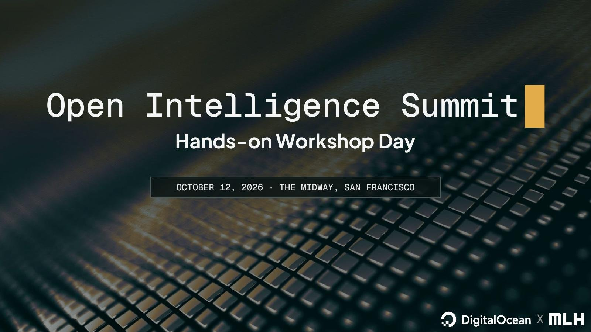
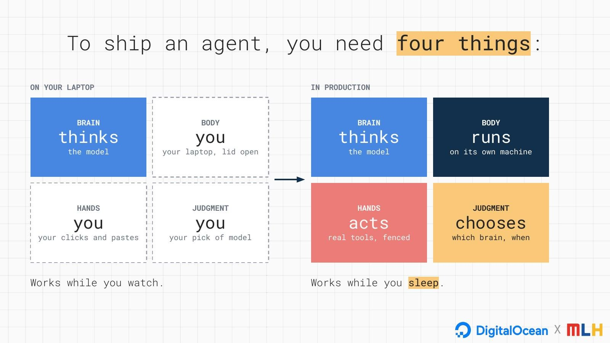
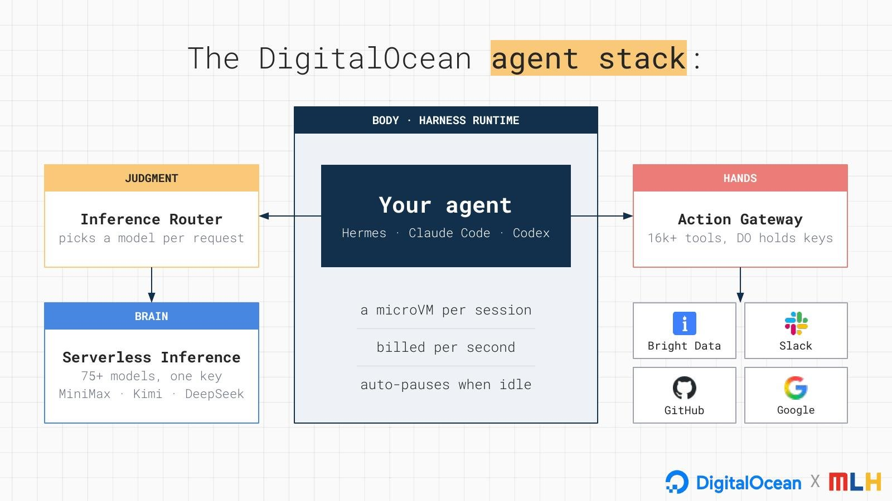
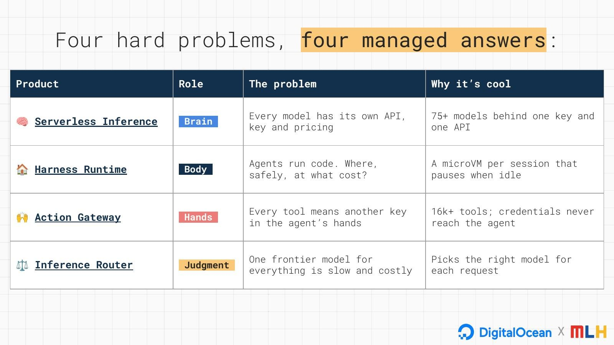
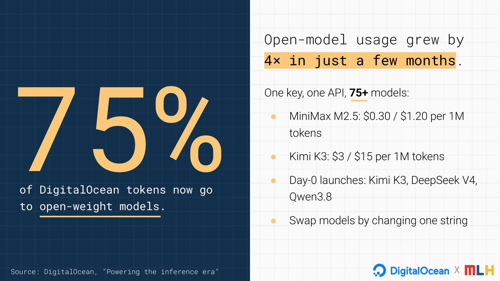
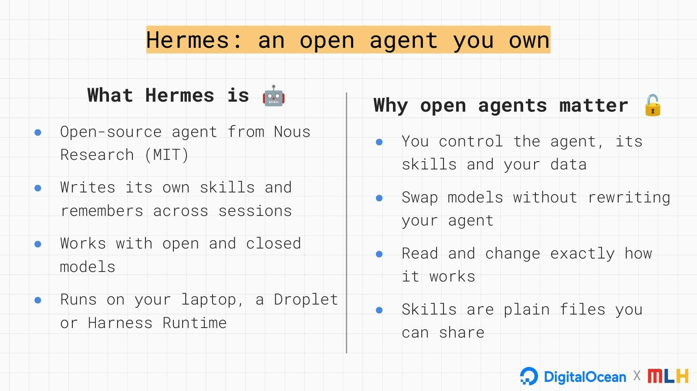
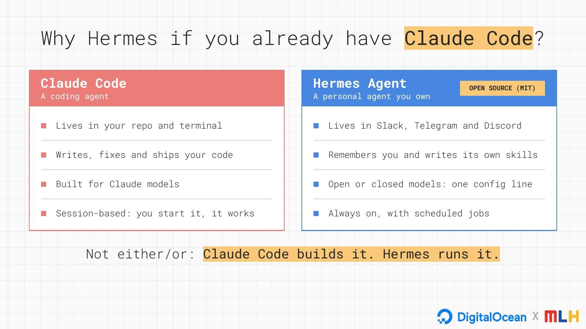
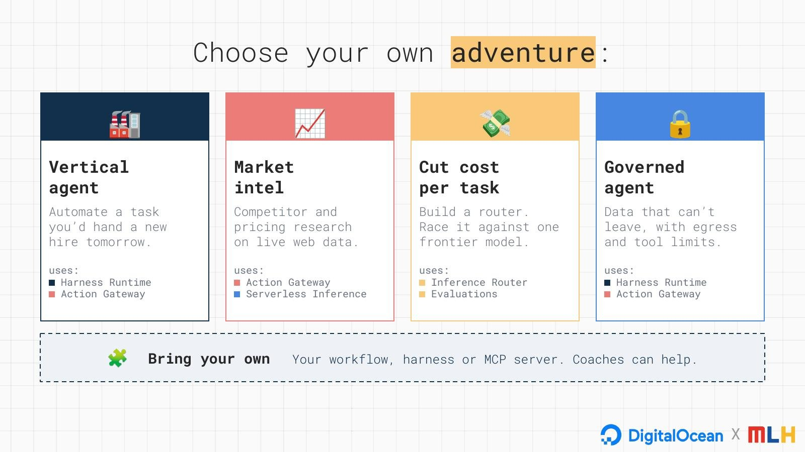
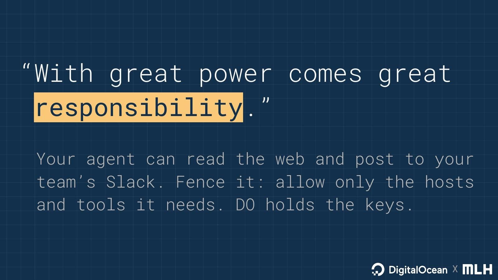
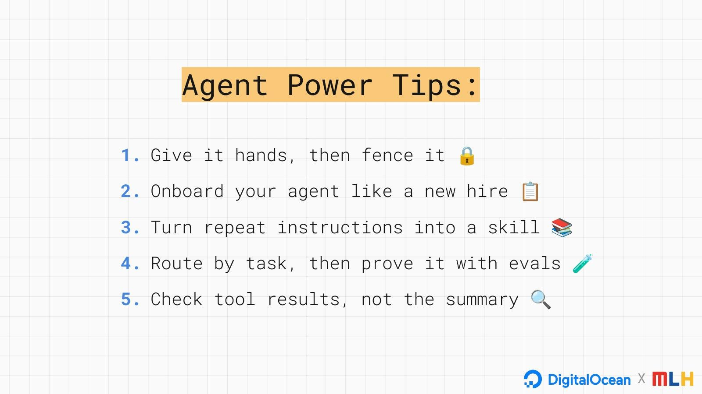

# Open Intelligence on DigitalOcean

**OIS Workshop Day · MLH × DigitalOcean · October 12, 2026 · The Midway, San Francisco**

Agents are moving from chat windows on your laptop to always-on workers in the cloud. DigitalOcean's new agent platform gives them the pieces they need to do that: open models, a machine of their own, safe access to real tools, a router that picks the right model, and evals that prove they work.

This repo is your companion for the day. Start with the ideas below, then build the agent from the live demo in **[DEMO.md](DEMO.md)**.

---

## What you'll learn

By the end of the day you'll be able to:

1. **Run an agent in production,** on its own machine with its own fence, instead of on your laptop with the lid open.
2. **Give an agent real tools safely:** web access and Slack through a managed gateway, with no keys in the agent.
3. **Choose models on purpose:** compare open and closed models, then let a router pick one per request.
4. **Prove a change helps** with an eval instead of a gut feeling.
5. **Own your agent,** with an open-source harness, plain-file skills and models you can swap.

---

## To ship an agent, you need four things

On your laptop, you are the agent's body, hands and judgment. You keep it running, you click and paste for it, and you pick the model. In production, each of those needs to be handled for you, so the agent works while you sleep.

---

## The DigitalOcean agent stack

| Piece | Role | What it gives you |
|---|---|---|
| **Serverless Inference** | Brain | 75+ open and closed models behind one API. Swap models by changing one string. |
| **Harness Runtime** | Body | A microVM per agent session, billed per second, that auto-pauses when idle. Run Hermes, Claude Code or Codex. |
| **Action Gateway** | Hands | 16k+ tools, including the Bright Data tools for reading the live web, Slack, GitHub and Google Workspace. DigitalOcean holds the credentials, so they never reach the agent. |
| **Inference Router** | Judgment | Picks a model for each request based on tasks you describe, with a fallback. |
| **Evaluations** | Proof | Runs a dataset through a model or router and has a judge model score every answer. |

---

## Why open models, why now

75% of DigitalOcean tokens now go to open-weight models, and open-model usage grew 4× in just a few months (source: DigitalOcean, "Powering the inference era"). Open models give you choice on price, speed and where your data goes, and a router lets you mix them with frontier models where it counts.

---

## Hermes: an open agent you own

[Hermes](https://github.com/NousResearch/hermes-agent) is an open-source agent from Nous Research (MIT license). It writes its own skills, remembers across sessions, and works with open and closed models. It runs on your laptop, a Droplet, or Harness Runtime.

It isn't either/or: **Claude Code builds it. Hermes runs it.**

---

## Build it

Follow **[DEMO.md](DEMO.md)** to build the agent from the live demo in six steps:

1. Pick any model
2. Describe your agent in one file
3. Give it hands, then fence it
4. Post to Slack *(optional)*
5. Prove it with an eval
6. Let a router pick the model

The repo includes everything you need:

| Path | What it is |
|---|---|
| [`DEMO.md`](DEMO.md) | The live demo, step by step |
| [`environment.yaml`](environment.yaml) | A reference manifest for the agent |
| [`skills/digitalocean-action-gateway/`](skills/digitalocean-action-gateway/SKILL.md) | A sample skill: how an agent should use tools through DigitalOcean's Action Gateway |
| [`evals/`](evals/) | Two evals: one model vs. another, and an agent with vs. without the skill |

---

## Pick your adventure

After the demo, build something real. Demos start at **1:30**, 3–5 minutes each: show what your agent does and which DigitalOcean product made it easier.

| Adventure | What you build | Uses |
|---|---|---|
| 🏭 Vertical agent | Automate a task you'd hand a new hire tomorrow. | Harness Runtime, Action Gateway |
| 📈 Market intel | Competitor and pricing research on live web data. | Action Gateway, Serverless Inference |
| 💸 Cut cost per task | Build a router and race it against one frontier model. | Inference Router, Evaluations |
| 🔒 Governed agent | Data that can't leave, with egress and tool limits. | Harness Runtime, Action Gateway |
| 🧩 Bring your own | Your own workflow, harness or MCP server. | Whatever you need |

---

## With great power comes great responsibility

- **Never paste a key, password or token into a chat or a prompt.** The agent doesn't need one: DigitalOcean holds the keys.
- **Give the agent only the tools and hosts it needs.** An agent can't misuse a tool it doesn't have.
- **Check tool results, not the summary.** If it matters, open the tool call and look.
- **Clean up** when you're done: delete sessions, environments and routers you no longer need.

---

## Learn more

- [DigitalOcean Harness Runtime docs](https://docs.digitalocean.com/products/managed-agents/agent-harness-runtime/)
- [Action Gateway docs](https://docs.digitalocean.com/products/managed-agents/action-gateway/)
- [Inference docs](https://docs.digitalocean.com/products/inference/), including [Inference Router](https://docs.digitalocean.com/products/inference/how-to/use-inference-router/) and [Evaluations](https://docs.digitalocean.com/products/inference/how-to/evaluate-models/)
- [Hermes Agent on GitHub](https://github.com/NousResearch/hermes-agent)

Stuck at the event? Raise your hand. Coaches from MLH, DigitalOcean and Bright Data are on the floor.
